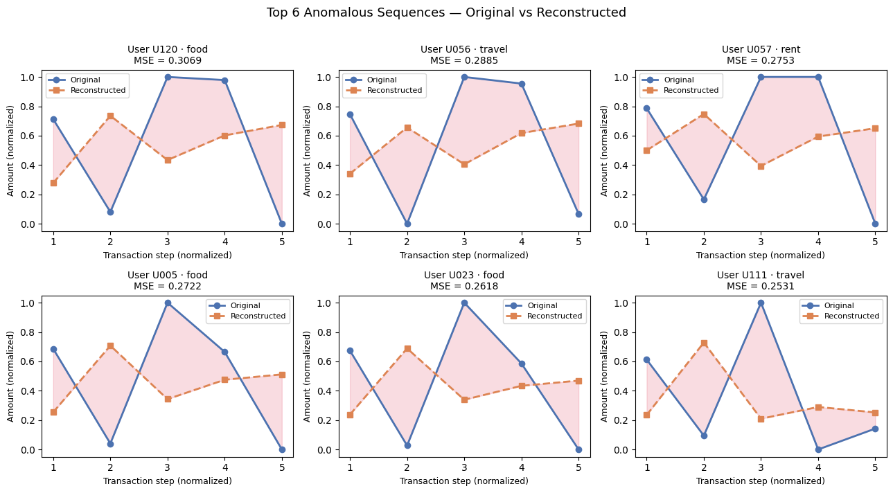

# Freelance Finance Deep Learning Project

Sriraghav Bavineni · University of Oregon

Started as the **DSCI 410L (Introduction to Deep Learning)** class project; being extended into a **Clark Honors College thesis** (defense Spring 2027). This README describes the current state. The thesis phase found and fixed three problems in the class-project pipeline (data parsing, input scaling, and the anomaly evaluation itself); the original numbers are kept at the end and clearly marked **superseded**.

---

## Project Purpose

Many individuals, especially freelancers, experience irregular income and spending patterns that make budgeting and financial planning difficult. This project investigates how deep learning can identify unusual financial behavior from transaction histories — not by forecasting future spending, but by learning what *normal* spending looks like and flagging what deviates from it.

The pipeline has four stages:

```
transactions → LSTM autoencoder flags unusual sequences → plain-language explanation → educational tax set-aside note
```

The detector is an **LSTM sequence autoencoder** over windows of 5 transactions in one (user, category) history. It requires no labeled anomalies. The explanation layer turns each flag into a short plain-language description. **Every number in an explanation is computed in code; the language model only phrases them**, and an automatic grounding check rejects language-model text that contradicts the data.

Results are educational only and are not financial or tax advice.

---

## Dataset

**BudgetWise Personal Finance Dataset**
Source: https://www.kaggle.com/datasets/mohammedarfathr/budgetwise-personal-finance-dataset

15,900 rows, 150 users, 2021–2024, fields `transaction_id`, `user_id`, `date`, `transaction_type`, `category`, `amount`, `payment_mode`, `location`, `notes`.

**Data quality (all handled in `dataloader.py`):**
- *Category spellings:* 46 raw spellings (e.g. `FOOD`, `Fod`, `Foods`) map to 13 canonical categories.
- *Mixed date formats:* `2023-04-25`, `08/05/2022` (always month/day/year), `31-12-23` and `21-09-2024` (always day-month). The original loader parsed only ISO dates and silently dropped the rest.
- *Amounts with currency text:* `₹5070`, `Rs.828`, `5107 INR` (the data is in **rupees**). The original loader dropped these too.
- *Result of the two fixes:* the original loader kept **4,977 of 15,900 rows (31%)**; robust parsing plus removing about 840 duplicate rows keeps **14,011 (88%)**. 1,048 rows are genuinely missing a required field.
- *Corrupt amounts:* 373 rows are `999999999`, `999999`, zero, or negative. Because each row sits in up to 5 overlapping windows, they touch **1,147 of 7,633 sequences (15%)**. The `--clean` option drops them (13,638 rows, **7,281 sequences**).
- *Realism:* amounts look randomly generated rather than behavioral (e.g. one user's rent swings between 1,370 and 16,334), so conclusions about real spending should not be drawn.

**Sequences:** transactions are grouped by `(user_id, category)`, sorted by date, and a sliding window of 5 produces overlapping sequences. After cleaning: 7,281 sequences from all 150 users, but skewed: food, rent, and travel are 71%; freelance income has only 28 sequences.

**Dataset location:** `data/budgetwise_finance_dataset.csv`

---

## Input features

Each amount is converted to **log(amount / the user's typical amount for that category)**, where "typical" is the median of that user's valid amounts in the category. A value of 0 means typical, +1.1 means about 3× typical, −1.1 about a third. This keeps absolute size, unlike the class project's per-sequence min-max scaling (still available as `--features minmax`). The typical amount is computed from each user's whole history, including users later used for validation (no labels are involved, but it is a mild look-ahead).

---

## Repository Structure

```text
freelance-finance-dl/
├── freelance_finance_dl/
│   ├── dataloader.py          # Parsing, cleaning, sequences, features, user-level split
│   ├── model.py               # LSTM sequence autoencoder
│   ├── train.py               # Training loop with checkpointing
│   ├── evaluate.py            # Scoring, threshold, raw-space and legacy anomaly injection
│   ├── sweep.py               # Raw-space injection sensitivity sweep and plots
│   ├── explain.py             # Facts, template baseline, LLM backends, grounding check
│   ├── tax.py                 # Educational quarterly set-aside estimate
│   ├── pipeline.py            # End-to-end report: flag -> explain -> tax note
│   ├── crossval.py            # 5-fold user-level cross-validation of the anomaly evaluation
│   ├── baseline.py            # Untrained one-line rule baselines on the same folds
│   ├── plots.py               # Thesis figures (data loss, flagged examples)
│   ├── stats.py               # Wilson confidence intervals
│   └── eval_explanations.py   # Explanation quality evaluation
├── checkpoints/
│   ├── primary_logratio_l3/             # PRIMARY: log-ratio features, latent 3, --clean
│   ├── ablation_logratio_l16/           # latent-size ablation
│   ├── robust_minmax/, robust_minmax_clean/   # robust parsing, min-max features
│   └── legacy_minmax_*/                 # class-project models (sequence-level and user-level split, clean)
├── docs/
│   ├── figures/                         # data-loss chart, flagged-sequence examples
│   ├── sweeps/                          # raw-space sweeps and cross-validation (CSV + PNG)
│   ├── explanation_eval/                # explanation scoring sheets, keys, summaries (v2, v3, v4)
│   │   └── llm_runs/                    # raw LLM outputs from early prompt versions
│   └── superseded/                      # class-project figures and sweeps (out-of-range injection)
├── thesis/                              # outline, abstract, chapters 1-6, appendices, references (first draft by Claude, to be rewritten by the author)
└── notebooks/                 # original class-project notebooks (NOT updated, see below)
```

---

## Installation

```bash
git clone https://github.com/sraghbav/freelance-finance-dl.git
cd freelance-finance-dl
pip install -e .
pip install -r requirements.txt
```

**Optional, for LLM explanations (free, local):** install [Ollama](https://ollama.com), `ollama pull llama3.2:3b`, and keep `ollama serve` running. The Anthropic API backend (`--llm anthropic`, needs `ANTHROPIC_API_KEY`) exists but was **not tested**.

---

## How to Run

```bash
# Train the primary model (log-ratio features, cleaned amounts, latent size 3)
python -m freelance_finance_dl.train --output-dir checkpoints/primary_logratio_l3 --latent-dim 3 --epochs 50 --clean

# Reproduce the class-project pipeline instead
python -m freelance_finance_dl.train --output-dir checkpoints/legacy_rerun --legacy-parsing --features minmax

# Raw-space sensitivity sweep -> docs/sweeps/rawsweep_<tag>.csv/.png
python -m freelance_finance_dl.sweep --checkpoint checkpoints/primary_logratio_l3/best_model.pt --tag primary

# Cross-validation (run each config, then summarize) and figures
python -m freelance_finance_dl.crossval --config logratio_l3   # also logratio_l16, minmax_l3
python -m freelance_finance_dl.crossval --summarize
python -m freelance_finance_dl.baseline            # untrained rule baselines
python -m freelance_finance_dl.plots

# End-to-end report (add --llm ollama for model-written explanations)
python -m freelance_finance_dl.pipeline --top-n 10 --llm ollama

# Explanation evaluation: generate -> fill the blind sheet -> summarize
python -m freelance_finance_dl.eval_explanations --n 20 --tag _v4
python -m freelance_finance_dl.eval_explanations --summarize --tag _v4 --scores <scored.csv>
```

Older checkpoints record how they were trained, so they reload with the right parsing and features automatically.

---

## Model

`TransactionAutoencoder` (`model.py`): an LSTM encoder reads the 5-step sequence and its final hidden state is projected to a **latent vector of size 3**; a decoder repeats the projected latent across 5 steps, runs a second LSTM, and outputs one value per step. Input and output shape `(batch, 5, 1)`; hidden size 64.

The latent size matters. With 5 inputs, a 16-dimensional latent has room to simply copy the input, so reconstruction error stops meaning "unusual". Size 3 forces compression.

---

## Results

### Why the original evaluation was wrong

The class project tested the detector by overwriting one *normalized* value with 2.0 or −0.5. Normalized data only ranges from 0 to 1, so those anomalies were out of range by construction, and the 98.2% spike recall (100% after the first fix) only showed that the model could detect out-of-range numbers. A realistic anomaly changes a **raw amount** (one charge ×5, say) and is then featurized like any other sequence. `evaluate.raw_injection_eval` does this: it multiplies (spike) or divides (drop) one amount by a factor, using only sequences with valid amounts (1,070 validation sequences for the primary model).

**Recall at a ~5% false-positive rate, mean-error score** (`docs/sweeps/rawsweep_*.csv`):

| Model | Spike ×3 | ×5 | ×10 | Drop ÷3 | ÷5 | ÷10 |
|---|---|---|---|---|---|---|
| Class-project model (min-max, 4,977 rows, n=127) | 8% | 2% | 1% | 4% | 3% | 6% |
| Robust parsing, min-max features | 2% | 2% | 1% | 4% | 5% | 4% |
| Log-ratio, latent 16 | 11% | 20% | 43% | 8% | 13% | 20% |
| **Log-ratio, latent 3 (primary)** | **13%** | **26%** | **52%** | 8% | 10% | 13% |

With min-max features every model is **at chance** (recall ≈ the 5% false-positive rate), even for a charge ten times too large, because per-sequence scaling discards absolute size. Log-ratio features recover part of the signal. Detection is still weak: spikes below ×3 are essentially undetected, and drops are poorly detected at any size. The amounts in this dataset look near-random, which limits what any detector can find.

### Cross-validation across users

The table above comes from one split (22 validation users). To check it does not depend on which users were held out, each configuration was re-trained 5 times, each time holding out a different fifth of the users (30 users per fold; 50 epochs, final weights, threshold calibrated on the held-out fold as before). **Recall at a ~5% false-positive rate, mean ± sd over the 5 folds** (`docs/sweeps/crossval_summary.csv`, figure `docs/sweeps/crossval_comparison.png`):

| Configuration | Spike ×3 | ×5 | ×10 | Drop ÷3 | ÷5 | ÷10 |
|---|---|---|---|---|---|---|
| **Log-ratio, latent 3 (primary)** | 11.7 ± 1.5% | 23.7 ± 3.0% | **49.7 ± 3.5%** | 7.7 ± 1.0% | 9.5 ± 0.9% | 12.6 ± 1.1% |
| Log-ratio, latent 16 | 9.7 ± 1.3% | 16.0 ± 1.9% | 38.1 ± 2.5% | 9.1 ± 0.8% | 13.4 ± 1.8% | 21.9 ± 2.5% |
| Min-max, latent 3 (class-project scaling) | 2.9 ± 0.9% | 2.4 ± 0.7% | 4.0 ± 3.9% | 4.0 ± 0.9% | 4.1 ± 0.8% | 4.5 ± 0.7% |

The single-split result (52% at ×10) is consistent with the cross-validated 49.7 ± 3.5%. Min-max scaling is at or *below* chance: spiked sequences are flagged slightly less often than clean ones. **Use the fold-to-fold sd as the uncertainty.** The Wilson intervals stored in the CSVs treat all sequences as independent, but overlapping windows from one user are correlated, so those intervals (for example ±1 point) are too narrow.

### Comparison with untrained rules, and what the data looks like

A rule with no training, computed from the same log-ratio features, was scored on the same folds and injected anomalies (`freelance_finance_dl/baseline.py`, `docs/sweeps/baseline_rule_summary.csv`, figure `docs/figures/detector_vs_rules.png`):

| Recall (%), mean ± sd over 5 folds | Spike ×3 | ×5 | ×10 | Drop ÷3 | ÷5 | ÷10 |
|---|---|---|---|---|---|---|
| Autoencoder, latent 3 (primary) | 11.7 ± 1.5 | 23.7 ± 3.0 | 49.7 ± 3.5 | 7.7 ± 1.0 | 9.5 ± 0.9 | 12.6 ± 1.1 |
| Rule: largest \|log-ratio\| (direction unknown) | 4.1 ± 0.4 | 6.2 ± 0.5 | 13.7 ± 1.8 | 9.1 ± 0.5 | 12.9 ± 1.1 | 22.9 ± 2.2 |
| Rule: largest log-ratio (assumes a spike) | 19.4 ± 2.5 | 41.5 ± 4.4 | **74.4 ± 1.7** | | | |
| Rule: most negative log-ratio (assumes a drop) | | | | 9.1 ± 0.6 | 13.0 ± 1.1 | **23.1 ± 2.3** |

The direction-aware rules use knowledge a deployed detector would not have, but they show that **a one-line rule matches or beats the autoencoder** on this data. The data explain why: within a user and category the lag-1 autocorrelation of log-amount averages −0.07 (509 groups), and the share of log-amount variance explained by user is about 0 (−0.004 food, −0.004 rent, −0.007 travel). Non-rent expense amounts never exceed 10,000 (99th percentile 9,744 to 9,932) while 35% of rent amounts do (99th percentile 48,986). There is no per-user or time structure for a sequence model to exploit, and 233 of the 349 flagged windows (67%) are rent windows, although rent is 24% of windows.

### Primary model

Log-ratio features, latent 3, cleaned amounts: 7,281 sequences, split by user (128 train users / 22 validation users; 6,211 / 1,070 sequences). Validation MSE 0.151; anomaly threshold (95th percentile of validation error) 0.522; **349 of 7,281 sequences flagged (4.8%)**. The top flags are now large deviations from the user's own typical amount (e.g. 368 against a typical 12,405; 116 against 5,645), not just windows with high spread.

**Latent size:** latent 16 reaches validation MSE 0.0005 (it copies its input); latent 3 reaches 0.151. Latent 3 detects spikes better (52% vs 43% at ×10); latent 16 detects drops slightly better (20% vs 13%).

**Mean vs. max scoring** (error averaged over the 5 positions vs. worst position): equivalent (spike ×10: 52% vs 54%; the earlier hypothesis that averaging diluted drop signals was not supported).

### Explanation layer evaluation

For 20 randomly chosen flagged sequences each, explanations were written two ways — a rule-based **template** and a **local LLM** (llama3.2:3b via Ollama, temperature 0) — and scored on four 1/0 criteria: direction correct, numbers correct and used correctly, plain language, no invented causes. A strict **grounding check** rejects LLM text with a wrong direction, placeholders, currency symbols, invented data-entry errors, or numbers not in the facts, and falls back to the template.

| | LLM v2 prompt | LLM v3 prompt | LLM v3 prompt, primary model (v4) | Template (all versions) |
|---|---|---|---|---|
| All four criteria OK | 55% | 65% | **95%** | 90–100% |
| Numbers correct and used correctly | 65% | 80% | 95% | 100% |
| No invented causes | 100% | 90% | 100% | 100% |
| Shipped text (LLM if it passes the check, else template) | 60% | 90% | 95% | 90–100% |

v2 and v3 were run on flagged sequences from the earlier min-max model; v4 on the primary model. **The versions are not directly comparable:** the primary model's flags are large, clear deviations (1.5× to 8× the user's typical amount), which makes the explanation task easier. v3 stopped sending the detector's internal score fields to the model (v2 mislabeled a severity ratio as "the threshold"). The checker passed 20 of 20 v4 texts, and the one it should have rejected ("4 positions higher than the median", a window position misused as a quantity) is the same kind of misuse it cannot see.

**Uncertainty.** With 20 sequences per round the 95% Wilson intervals are wide (all-four-criteria rate): LLM v2 55% (34–74%), v3 65% (43–82%), v4 95% (76–99%); template 90% (70–97%) in v2 and v3 and 100% (84–100%) in v4 (`*_ci.csv` beside each scoring file). The v4 LLM and template results are statistically indistinguishable, and v3 vs. template overlaps too; only v2 vs. template is close to separable.

**Scoring caveats.** Scores are from Claude acting as an LLM judge (`docs/explanation_eval/explanation_scoring_claude_v*.csv`), not independent humans. The student independently scored 12 of the v2 rows (`docs/explanation_eval/explanation_scoring_human_v2.csv`): **39/48 criterion judgements agreed (81%)**, 9/12 rows agreed on the overall verdict, and plain language was least consistent (58%). The student's rows were not repeated for v3/v4. The sheets are only weakly blind because template text is formulaic.

**Conclusion:** with a 3B model, the checked pipeline is about as accurate as the plain template; the LLM adds phrasing variety, not accuracy. A larger model was not evaluated.

---

## Discussion: Limitations and Use

**Limitations:**
- *Detection is weak:* about half of 10×-too-large charges are found at a 5% false-positive rate; 3× spikes, and drops of any size, mostly are not.
- *Data realism:* amounts look random, categories are skewed, and the dataset has 15,900 rows of which many were corrupt or duplicated. No claim here transfers to real spending.
- *Synthetic evaluation:* injected anomalies approximate but do not replace labeled ones; the injection design itself was wrong in the class project and is now in raw space.
- *Scaling uses full history,* including validation users' own amounts.
- *Repeated flags:* windows overlap, so one unusual transaction can trigger up to five flagged sequences (for example two of the six highest-scoring examples in `docs/figures/primary_flagged_examples.png` are the same 237 charge); counts of flagged sequences are not counts of unusual transactions.
- *Single feature:* only amount (no day of week, transaction type, or payment mode).
- *Explanation evaluation:* 20 sequences per round, one small local model, LLM-judge scores, a 12-row human check on one round, weakly blind. Not statistically powered.
- *Checker limits:* it verifies quoted numbers exist and direction is right, but cannot verify what a number is used for or catch every invented claim.
- *Tax module:* a flat 25% placeholder set-aside on freelance income minus candidate expense categories (travel, education, utilities). Not a tax calculation, and the data are in rupees, so no jurisdiction-specific rules apply.
- *Notebooks:* `notebooks/evaluation.ipynb` and `data_demo.ipynb` still reflect the class-project pipeline and have not been re-run.

**Intended use:** an educational prototype; not financial or tax advice.

---

## Original DSCI 410L Results (superseded)

Kept for the record. These used the original loader (4,977 rows, 1,104 sequences), min-max features, and the out-of-range injection described above, so the recall figures do not measure realistic detection. Weights: `checkpoints/legacy_minmax_sequence_split/` and `checkpoints/legacy_minmax_user_split/`; the figures and sweeps are in `docs/superseded/`.

| | Sequence-level split | User-level split |
|---|---|---|
| Final validation MSE | 0.0491 | 0.0577 |
| Flagged anomalies | 64 (5.8%) | 52 (4.7%) |
| Out-of-range spike / drop recall | 98.2% / 30.3% | 100% / 32.9% |

Moving to a user-level split (whole users held out) raised validation error, as expected once overlapping windows from the same user could no longer leak across the split.



---

## Generative AI Disclosure

### DSCI 410L class project

In accordance with the course syllabus policy on generative AI, the class project used Claude (Anthropic) as an assistant for code organization, docstrings and inline comments, debugging (tensor shape mismatches, category-normalization fallback logic), README drafting, suggesting the synthetic anomaly injection approach in response to instructor feedback, and running and verifying outputs. The core decisions — LSTM autoencoder, sequence generation, threshold methodology, and interpretation of results — were made by the student.

### Honors thesis extension (October 2026)

Claude (Anthropic, via Claude Code) was used substantially more in this phase. To state it plainly:

- **Student:** chose the thesis direction (explanation layer, tax note, free local model), wrote `get_user_split` in `dataloader.py` with Claude's guidance, ran commands, reviewed outputs, chose to fix the data parsing and to adopt the new features after Claude reported the problems, and independently scored 12 explanation rows.
- **Claude:** wrote the remaining new code (robust parsing and de-duplication, log-ratio features, raw-space anomaly injection, the sweep, `explain.py` including the grounding check, `tax.py`, `pipeline.py`, `eval_explanations.py`, and later `crossval.py`, `baseline.py`, `plots.py`, `stats.py`); ran the experiments; **identified** the data-loss, scaling, and evaluation-design problems described above; scored all explanation texts as an LLM judge (Claude also wrote the checker and prompts it scored, so it is not an independent rater); and drafted this README.
- The explanation layer's language model is a locally run open model (llama3.2:3b), so the explanation layer sends nothing to a third party. The development process is different: working with Claude through Claude Code sent code, command output, and excerpts of the public dataset (including transaction rows) to Anthropic. The dataset is public and appears synthetic.
- On 2026-11-12 Claude also drafted a full first draft of the thesis chapters in `thesis/`, to be rewritten by the student.
