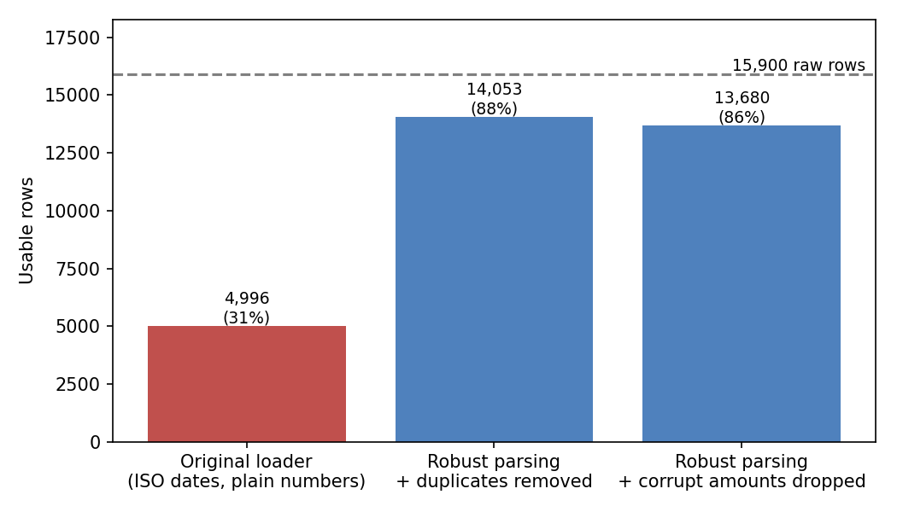
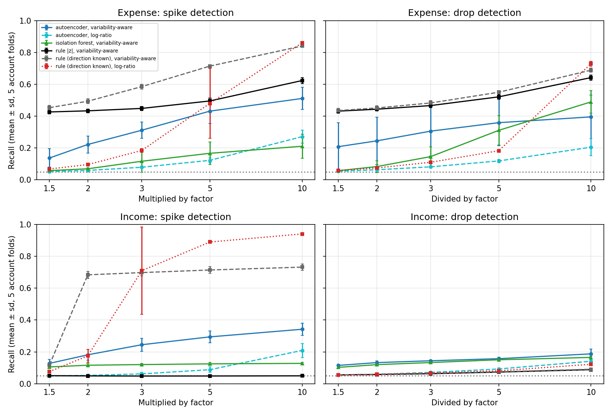
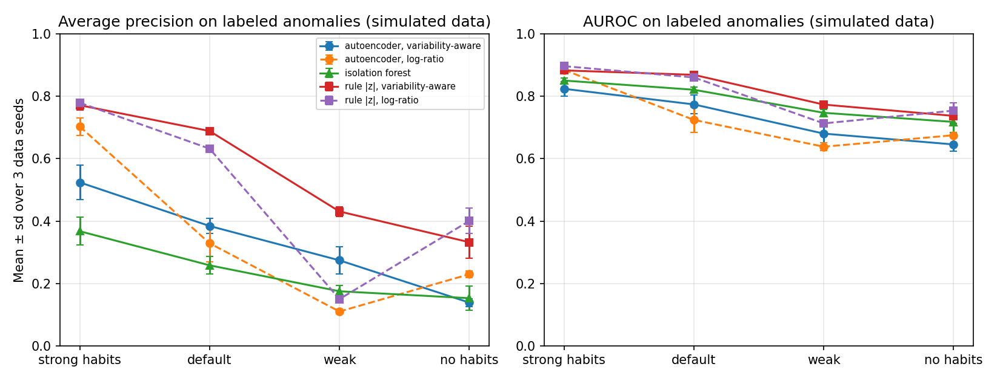

> **DRAFT written by Claude on 2026-11-12 (rewritten that night after the Berka and simulation runs) as a scaffold for the author to rewrite in their own words.** Every number was copied from `docs/sweeps/` or `docs/explanation_eval/`, or computed from the data, and cross-checked by script. Results are mean ± standard deviation across five folds unless stated. Three datasets are used: the original BudgetWise data, real bank data (Berka), and a simulation. `[CHECK]` = verify; `[YOUR CALL]` = your judgment.

# 4. Results

## 4.1 Four problems found in the course-project pipeline

**Data loss.** The original loader kept under a third of the data (Table 4.1, Figure 4.1).

**Table 4.1. Rows and windows kept at each stage.**

| Stage | Rows | % of 15,900 | Windows | Users with a window |
|---|---|---|---|---|
| Original loader (ISO dates, plain numbers) | 4,977 | 31.3% | 1,104 | 148 |
| Robust parsing, duplicates removed | 14,053 | 88.4% | 8,882 | 150 |
| Also dropping corrupt amounts (primary) | 13,680 | 86.0% | 8,537 | 150 |

The original loader produced no windows at all for freelance income or savings, and 87% of its windows came from food, rent, and travel. The corrected pipeline has windows for income and every expense category.

**Min-max scaling discards size.** Scaling each window to [0, 1] makes a window of 100 to 500 identical to one of 10,000 to 50,000. In the original pipeline, 173 of 1,104 windows (15.7%) contained a corrupt amount, yet only 4 of the 52 windows it flagged did, because one extreme value squashes the rest of its window toward zero, which the model reconstructs well.

**Windows mixed income and expenses, and income was nearly absent.** Windows were first grouped by user and category only. The category "other" exists on both the expense and the income side, so 108 of its 140 windows mixed income (median amount 44,814) with expenses (median 4,918) in one history. Income categories were also split five ways with about three transactions per user each, leaving only 144 income windows (2%). Grouping by user, transaction type, and category and pooling each user's income into one history gives 1,537 income windows (18%).

**The evaluation was invalid.** The original test overwrote a normalized value with 2.0 or −0.5, which cannot occur in normalized data (Section 3.6). It scored the course-project models at 98.2% spike recall (sequence-level split) and 100% (user-level split), which measured whether the model could detect an impossible input (Section 4.10).

## 4.2 The course-project detector, re-evaluated realistically

Re-testing by changing one raw amount (Section 3.6) gives Table 4.2. For every configuration that scales windows to [0, 1], recall equals the false-positive rate within a point or two. Under five-fold cross-validation on the current data, min-max scaling is at or below chance (for example 2.1 ± 0.5% for a fivefold spike, against a false-positive rate of about 5%).

**Table 4.2. Recall (%) at a ~5% false-positive rate with min-max scaling.**

| Evaluation | Spike ×3 | ×5 | ×10 | Drop ÷3 | ÷5 | ÷10 |
|---|---|---|---|---|---|---|
| Course-project model, one split (127 windows, FPR 6.3%) | 8 | 2 | 1 | 4 | 3 | 6 |
| Robust parsing, old grouping, one split (1,070 windows) | 2 | 2 | 1 | 4 | 5 | 4 |
| Current data, 5-fold cross-validation, latent 3 | 2.7 ± 0.4 | 2.1 ± 0.5 | 2.1 ± 1.5 | 4.4 ± 0.4 | 4.3 ± 0.4 | 4.7 ± 0.4 |

*(The first two rows used latent size 16, the course project's setting.)*

## 4.3 BudgetWise: cross-validated detection and one-line rules

With amounts expressed relative to the user's typical amount (Section 3.2), the autoencoder detects large spikes (Table 4.3, Figure 4.2). The primary configuration (log-ratio features, latent size 3) flags a charge ten times too large in **41.0 ± 3.7%** of cases, five times too large in 20.3 ± 2.8%, and three times too large in 10.1 ± 1.3%; it detects downward changes much less well (11.5 ± 0.9% at ÷10). A larger latent size of 16 does better on drops (21.0 ± 3.8% at ÷10) and worse on spikes (32.9 ± 7.5% at ×10). The variability-aware features, which divide by each history's own variability, change little on this data (36.6 ± 3.9% at ×10, within the spread of the 41.0 ± 3.7% of log-ratio features), which is expected because every category in BudgetWise is about equally random (Section 4.5). Scoring by the largest per-position error instead of the mean makes no material difference on the single split (spike ×10: 44.6% against 42.1%; drop ÷10: 12.1% against 13.8%), so the course-project hypothesis that averaging dilutes a single bad position is not supported.

Untrained one-line rules computed from the same features (Section 3.6) do at least as well. A rule that knows the anomaly is a spike reaches **73.6 ± 4.1%** at ×10 with log-ratio features, against the autoencoder's 41.0%, and a rule that knows it is a drop reaches 23.6 ± 2.4% at ÷10, above the primary autoencoder (11.5%) and about equal to the latent-16 one. The direction-unknown rule is weaker on spikes (15.3 ± 1.6%) and equal on drops (23.5 ± 2.5%), so the autoencoder, which is not told the direction, beats it on spikes and loses on drops, consistent with its having learned that very large values are rare in training (a hypothesis I did not test). The direction-aware rules use knowledge a deployed detector would not have; the point is that the autoencoder does not extract more from this data than a simple function of the features.

**Table 4.3. BudgetWise recall (%), all windows, mean ± sd over five user folds.**

| Detector | Spike ×3 | ×5 | ×10 | Drop ÷3 | ÷5 | ÷10 |
|---|---|---|---|---|---|---|
| **Autoencoder, log-ratio, latent 3 (primary)** | 10.1 ± 1.3 | 20.3 ± 2.8 | **41.0 ± 3.7** | 7.3 ± 1.1 | 8.9 ± 0.9 | 11.5 ± 0.9 |
| Autoencoder, log-ratio, latent 16 | 9.1 ± 1.0 | 15.2 ± 3.0 | 32.9 ± 7.5 | 8.5 ± 1.1 | 12.9 ± 2.2 | 21.0 ± 3.8 |
| Autoencoder, variability-aware, latent 3 | 14.4 ± 2.7 | 23.3 ± 3.7 | 36.6 ± 3.9 | 7.6 ± 1.3 | 9.3 ± 2.0 | 11.6 ± 2.0 |
| Autoencoder, min-max, latent 3 | 2.7 ± 0.4 | 2.1 ± 0.5 | 2.1 ± 1.5 | 4.4 ± 0.4 | 4.3 ± 0.4 | 4.7 ± 0.4 |
| Rule \|z\| (direction unknown), log-ratio | 5.0 ± 0.2 | 7.4 ± 0.8 | 15.3 ± 1.6 | 8.3 ± 0.4 | 12.3 ± 1.0 | 23.5 ± 2.5 |
| Rule, spike known, log-ratio | 16.3 ± 2.8 | 36.9 ± 6.9 | 73.6 ± 4.1 | n/a | n/a | n/a |
| Rule, drop known, log-ratio | n/a | n/a | n/a | 8.3 ± 0.4 | 12.4 ± 0.9 | 23.6 ± 2.4 |
| Rule \|z\| (direction unknown), variability-aware | 5.7 ± 0.5 | 8.4 ± 1.0 | 17.6 ± 2.8 | 7.9 ± 0.7 | 12.3 ± 1.1 | 22.8 ± 3.1 |

## 4.4 BudgetWise: expenses versus income

Because the intended use covers both unexpected expenses and unexpected income (Section 1.3), recall was also computed separately for each stream, with the threshold calibrated within the stream (Table 4.4, Figure 4.3). Expenses behave like the pooled results: the primary autoencoder finds 43.6 ± 3.0% of tenfold spikes against 76.0 ± 2.4% for the direction-aware rule.

Income differs. For an unexpectedly **low** income payment, a one-line rule is far better than the autoencoder: at a tenfold drop it flags 94.7 ± 1.4% of cases (59.7 ± 4.9% at ÷5), against 8.3 ± 0.9% for the primary autoencoder and 16.3 ± 8.5% for the latent-16 one; with variability-aware features the same rule reaches 64.1 ± 8.8%. A plausible reason is that income rarely falls below about 10,000 (first percentile 10,712), so a tenfold drop moves a payment out of the normal range, a boundary the rule uses directly; I did not test this. For unexpectedly **high** income all methods are weak and tied (about 24% at ×10 with a standard deviation of 8 to 10 points), perhaps because 4.6% of income amounts already exceed 100,000. Income has about 300 windows per fold, so these estimates are noisier. Section 4.6 shows that on real bank data the income result is different.

**Table 4.4. BudgetWise recall (%) by stream, mean ± sd over five user folds.**

| Stream and detector | Spike ×5 | ×10 | Drop ÷5 | ÷10 |
|---|---|---|---|---|
| **Expense** (7,000 windows): autoencoder, log-ratio, latent 3 | 23.0 ± 3.5 | 43.6 ± 3.0 | 9.5 ± 1.0 | 12.0 ± 1.2 |
| Expense: autoencoder, variability-aware, latent 3 | 24.3 ± 3.9 | 37.4 ± 4.5 | 9.5 ± 2.4 | 12.4 ± 2.4 |
| Expense: rule, direction known, log-ratio | 42.8 ± 5.2 | 76.0 ± 2.4 | 11.9 ± 1.0 | 21.8 ± 1.3 |
| **Income** (1,537 windows): autoencoder, log-ratio, latent 3 | 9.9 ± 4.8 | 24.4 ± 9.1 | 6.9 ± 1.4 | 8.3 ± 0.9 |
| Income: autoencoder, log-ratio, latent 16 | 10.5 ± 3.0 | 23.2 ± 8.2 | 10.4 ± 4.3 | 16.3 ± 8.5 |
| Income: autoencoder, variability-aware, latent 3 | 16.5 ± 5.2 | 30.9 ± 8.9 | 7.8 ± 2.0 | 10.3 ± 2.5 |
| Income: rule, direction known, log-ratio | 8.0 ± 1.4 | 24.5 ± 10.1 | **59.7 ± 4.9** | **94.7 ± 1.4** |
| Income: rule, direction known, variability-aware | 14.9 ± 7.8 | 32.8 ± 13.6 | 35.0 ± 10.2 | 64.1 ± 8.8 |

## 4.5 BudgetWise: what the data look like, and the primary model

**Structure.** Several measurements suggest the BudgetWise data contain no per-user or time structure for a sequence model to learn (cleaned data). The share of variance in log-amount explained by user (intraclass correlation) is −0.004 for food, −0.004 for rent, and −0.007 for travel across all 150 users, and −0.001 for pooled income: indistinguishable from zero. The lag-1 autocorrelation of log-amount within a user and category averages −0.070 (standard deviation across 509 histories 0.241); for pooled income it is −0.107 (131 histories). For every expense category except rent, essentially no amount exceeds 10,000 (99th percentile 9,744 to 9,932), whereas 35.3% of rent amounts exceed 10,000 (Table 4.5); income amounts have a median of 46,713, a first percentile of 10,712, and a heavy tail (4.6% above 100,000). I describe the data as synthetic for these reasons: real rent, in particular, is usually persistent per user `[YOUR CALL: this is an inference, not a measured fact]`.

**Table 4.5. BudgetWise expense amounts by category (cleaned data).**

| Category | Median | 90th pct | 99th pct | Share above 10,000 |
|---|---|---|---|---|
| food | 3,370 | 7,875 | 9,744 | 0.0% |
| rent | 8,019 | 39,219 | 48,986 | 35.3% |
| travel | 5,133 | 9,036 | 9,912 | 0.0% |
| utilities | 5,077 | 8,994 | 9,866 | 0.0% |
| entertainment | 5,122 | 9,044 | 9,924 | 0.0% |
| education | 5,305 | 9,187 | 9,932 | 0.0% |
| health | 5,135 | 8,783 | 9,860 | 0.0% |

**The primary model.** The primary model (log-ratio features, latent size 3) was trained on 7,289 windows from 128 users and has a validation error of 0.144 (0.0004 for latent 16, which nearly copies its input). The 95th-percentile threshold of the 1,248 validation windows' errors is 0.573, and over all 8,537 windows **383 (4.5%)** are flagged: 273 of 7,000 expense windows (3.9%) and 110 of 1,537 income windows (7.2%). Flagged windows show larger deviations (median largest absolute log-ratio 2.16 against 1.31). The flags are concentrated in one category (Table 4.6): 211 of the 383 (55.1%) are rent windows, although rent is 20.3% of all windows, because rent amounts are far more spread out. Because windows overlap, one unusual transaction can appear in up to five flagged windows, so flag counts are not counts of unusual transactions.

**Table 4.6. Flagged windows by category.**

| Category | Flagged / windows |
|---|---|
| rent | 211 / 1,737 |
| income (pooled) | 110 / 1,537 |
| food | 29 / 2,330 |
| travel | 17 / 1,140 |
| utilities | 6 / 793 |
| education | 5 / 334 |
| entertainment | 3 / 558 |
| health | 2 / 92 |

## 4.6 Real bank data (Berka)

The Berka data are the real-data test. Unlike BudgetWise, they contain strong habits: standing payments are nearly constant per account (the share of variance explained by account is 0.999 for household payments, 1.000 for insurance and loan payments, 0.835 for transfers out, 0.447 for cash withdrawals, and 0.511 for pooled income). They contain no sequence dependence, however: the lag-1 autocorrelation of log-amount is 0.013 for expenses and −0.054 for income, and half of the windows come from histories whose variability is at the floor of 0.05. Tables 4.7 and 4.8 and Figure 4.5 give recall under five-fold cross-validation over accounts, with injected anomalies on a sample of 3,000 held-out windows per stream per fold (Section 3.11).

**Expenses.** The largest effect in this thesis is the variability-aware scaling. With it, the one-line rule that takes the largest absolute feature, without knowing the direction, catches **43 ± 1%** of windows in which one expense is changed by a factor of 1.5 (up or down) at a false-positive rate of about 5%, and 62 ± 2% and 64 ± 2% at ×10 and ÷10. With log-ratio features, the same kind of rule catches only 5% to 7% at ×1.5, because a 50% change in a payment that never varies is not large in log-ratio terms. The autoencoder improves with variability-aware features (from 5 ± 0% to 14 ± 6% at ×1.5, and from 27 ± 4% to 51 ± 7% at ×10, at latent size 16) and with a larger bottleneck (30 ± 5% at ×10 with latent size 3), but it stays well below the rule at every factor, with large fold-to-fold variation at small factors. The Isolation Forest is weak for small changes (6%) and about as good as the autoencoder for large drops (49 ± 7% at ÷10). A rule that knows the direction reaches 84 ± 1% at ×10 and 69 ± 1% at ÷10.

**Income.** Income is harder. The direction-unknown rule with variability-aware features is at chance (5 ± 1% at ×10), because income histories are heavy-tailed: many income windows already contain a value far from the history's typical one, so the 95th-percentile threshold is very high; before I replaced the clip in the features (Section 3.2), 19.8% of income windows were at the cap. Rules that know the direction avoid this: for unexpectedly **high** income they reach 73 ± 2% at ×10 with variability-aware features and 94 ± 0% with log-ratio features, against 34 ± 4% for the autoencoder. For unexpectedly **low** income no method does well: the best autoencoder reaches 19 ± 3% at ÷10, and the best rule 12 ± 1%. This contrasts with BudgetWise, where a one-line rule caught 94.7% of tenfold drops in income, so the ease of detecting low income depends on the data.

**Table 4.7. Berka expense stream: recall (%), mean ± sd over five account folds.**

| Detector | Spike ×1.5 | ×3 | ×10 | Drop ÷1.5 | ÷3 | ÷10 |
|---|---|---|---|---|---|---|
| Autoencoder, variability-aware, latent 16 | 14 ± 6 | 31 ± 5 | 51 ± 7 | 21 ± 15 | 31 ± 16 | 40 ± 14 |
| Autoencoder, variability-aware, latent 3 | 6 ± 0 | 11 ± 1 | 30 ± 5 | 8 ± 3 | 8 ± 1 | 15 ± 1 |
| Autoencoder, log-ratio, latent 16 | 5 ± 0 | 8 ± 1 | 27 ± 4 | 5 ± 0 | 8 ± 1 | 21 ± 5 |
| Isolation Forest, variability-aware | 6 ± 1 | 12 ± 7 | 21 ± 7 | 6 ± 0 | 15 ± 6 | 49 ± 7 |
| **Rule \|z\| (direction unknown), variability-aware** | **43 ± 1** | **45 ± 1** | **62 ± 2** | **43 ± 1** | **47 ± 1** | **64 ± 2** |
| Rule, direction known, variability-aware | 45 ± 1 | 59 ± 2 | 84 ± 1 | 44 ± 1 | 48 ± 1 | 69 ± 1 |
| Rule \|z\| (direction unknown), log-ratio | 5 ± 0 | 7 ± 0 | 40 ± 18 | 6 ± 0 | 10 ± 0 | 40 ± 18 |
| Rule, direction known, log-ratio | 7 ± 0 | 18 ± 1 | 86 ± 1 | 6 ± 1 | 11 ± 0 | 73 ± 2 |

**Table 4.8. Berka income stream: recall (%), mean ± sd over five account folds.**

| Detector | Spike ×1.5 | ×3 | ×10 | Drop ÷1.5 | ÷3 | ÷10 |
|---|---|---|---|---|---|---|
| Autoencoder, variability-aware, latent 16 | 13 ± 3 | 24 ± 4 | 34 ± 4 | 11 ± 1 | 14 ± 1 | 19 ± 3 |
| Autoencoder, log-ratio, latent 16 | 5 ± 0 | 6 ± 1 | 21 ± 4 | 5 ± 0 | 7 ± 1 | 14 ± 1 |
| Isolation Forest, variability-aware | 11 ± 1 | 12 ± 1 | 13 ± 1 | 10 ± 1 | 13 ± 1 | 16 ± 1 |
| Rule \|z\| (direction unknown), variability-aware | 5 ± 0 | 5 ± 0 | 5 ± 1 | 6 ± 0 | 6 ± 0 | 9 ± 0 |
| Rule, direction known, variability-aware | 12 ± 1 | 70 ± 2 | 73 ± 2 | 6 ± 0 | 6 ± 0 | 9 ± 0 |
| Rule, direction known, log-ratio | 8 ± 1 | 71 ± 28 | 94 ± 0 | 5 ± 0 | 7 ± 0 | 12 ± 1 |

## 4.7 Simulation study

The simulation (Section 3.12) shows how detection quality depends on how much structure the data have. Table 4.9 gives average precision for windows containing a labeled anomaly, averaged over three data seeds, and Figure 4.6 shows AUROC and average precision with their spread. A one-line rule is best or tied at every habit level, and the autoencoder falls further behind as habits weaken. With strong habits the rule's average precision is 0.77 (variability-aware features) or 0.78 (log-ratio), against 0.70 for the best autoencoder (log-ratio features) and 0.37 for the Isolation Forest; with default habits the rule reaches 0.69 and the best autoencoder 0.38; with weak habits 0.43 and 0.27; and without habits 0.33 (or 0.40 with log-ratio features) and 0.23. The autoencoder's score depends on the feature type in a way that changes with the habit level: with log-ratio features it scores best with strong habits and worst with weak ones, and at weak habits variability-aware features score higher (0.27 against 0.11). The rules' rankings do not depend on how very large values are compressed. An earlier version of the variability-aware features, which clipped large values instead of compressing them with arcsinh, gave the autoencoder higher scores on this simulation; the lesson is that autoencoder results are sensitive to input transformation `[CHECK: I did not keep those earlier files]`.

**Table 4.9. Simulation: average precision for windows containing a labeled anomaly (mean over three seeds).**

| Detector | Strong habits | Default | Weak | No habits |
|---|---|---|---|---|
| Autoencoder, log-ratio, latent 16 | 0.70 | 0.33 | 0.11 | 0.23 |
| Autoencoder, variability-aware, latent 16 | 0.52 | 0.38 | 0.27 | 0.14 |
| Isolation Forest | 0.37 | 0.26 | 0.18 | 0.15 |
| Rule \|z\|, log-ratio | 0.78 | 0.63 | 0.15 | 0.40 |
| **Rule \|z\|, variability-aware** | **0.77** | **0.69** | **0.43** | 0.33 |

**Anomaly types.** Spikes and drops (large changes in amount) are detected well by the rules and moderately by the autoencoder (Table 4.10, default habits). **Seasonal and duplicate anomalies, which break a pattern in a sequence without being large in amount, are not found by any detector**: their AUROC is between 0.29 and 0.62 and their average precision between 0.01 and 0.03 (the highest, 0.62 for duplicates, is shared by the Isolation Forest and the log-ratio rule, with an average precision of 0.02). The autoencoder reads a window of five amounts, which in principle contains the seasonal curve and the repeated value, but it did not learn to use them, even though the simulated data contain this structure. This agrees with the near-zero autocorrelation of the BudgetWise and Berka data (Sections 4.5 and 4.6).

**Table 4.10. Simulation, default habits: AUROC / average precision by anomaly type (mean over three seeds).**

| Detector | Spike | Drop | Seasonal | Duplicate |
|---|---|---|---|---|
| Autoencoder, log-ratio | 0.77 / 0.25 | 0.82 / 0.34 | 0.48 / 0.01 | 0.52 / 0.01 |
| Autoencoder, variability-aware | 0.86 / 0.34 | 0.84 / 0.39 | 0.51 / 0.02 | 0.57 / 0.02 |
| Isolation Forest | 0.90 / 0.15 | 0.91 / 0.21 | 0.48 / 0.01 | 0.62 / 0.02 |
| Rule \|z\|, log-ratio | 0.97 / 0.72 | 0.97 / 0.75 | 0.29 / 0.03 | 0.62 / 0.02 |
| Rule \|z\|, variability-aware | 0.97 / 0.82 | 0.98 / 0.86 | 0.44 / 0.03 | 0.60 / 0.02 |

**Income and expenses.** In the simulation the income stream is easy for the rules (average precision 1.00 with strong habits and 0.95 to 0.98 with default habits) and somewhat harder for the autoencoder (0.79 to 0.98 with strong habits, 0.55 to 0.57 with default habits).

**Per-category test.** A separate injection test on clean simulated data (default habits, no labeled anomalies, one split of 100 users, one global threshold; Table 4.11) isolates the effect of variability-aware features. With log-ratio features, a 50% rise in rent or in a subscription is never caught (0%), because the single threshold is set by the volatile categories; with variability-aware features both the autoencoder and the rule catch **100%** of them with 0% false alarms, and 3× changes in rent and subscriptions. Volatile categories stay hard for small changes (groceries 13%, dining 10% at ×1.5), where the rule does somewhat better than the autoencoder at ×3 (75% and 43% against 61% and 35%).

**Table 4.11. Simulation per-category test, spike recall (%) at ×1.5 / ×3 / ×10 (variability-aware features, latent 16).**

| Detector | Rent | Subscription | Utilities | Income | Groceries | Dining |
|---|---|---|---|---|---|---|
| Autoencoder | 100 / 100 / 100 | 100 / 100 / 100 | 5 / 68 / 100 | 43 / 77 / 100 | 13 / 61 / 100 | 10 / 35 / 92 |
| Rule \|z\| (direction unknown) | 100 / 100 / 100 | 100 / 100 / 100 | 4 / 93 / 100 | 44 / 85 / 100 | 13 / 75 / 100 | 10 / 43 / 98 |
| *Same, log-ratio features: autoencoder* | *0 / 18 / 100* | *0 / 18 / 100* | *0 / 13 / 100* | *1 / 19 / 97* | *4 / 23 / 96* | *15 / 40 / 94* |

## 4.8 Explanation evaluation

An informal first trial (v1, five windows, outputs in `docs/explanation_eval/llm_runs/`) showed the small model stating the wrong direction once, never mentioning the flagged amount twice, and adding content that is not in the facts (a dollar sign, a data-entry error) in four. Six structured rounds followed (Section 3.8); Table 4.9 gives the share of texts fully correct, as judged by Claude, with 95% Wilson intervals.

**Table 4.9. Explanation rounds (20 windows each; LLM-judged).**

| Round | Windows | Language model fully correct (95% interval) | Template | What happened |
|---|---|---|---|---|
| v2 | course-project detector's flags | 55% (34–74) | 90% (70–97) | seven texts called a score ratio "the threshold of 1.06" |
| v3 | same 20 windows | 65% (43–82) | 90% (70–97) | a currency symbol, wrong differences, invented causes |
| v4 | earlier primary model (before the grouping fix) | 95% (76–99) | 100% (84–100) | one window position used as a quantity |
| v5 | new primary model, income included | 70% (48–85) | 100% (84–100) | **four of five income texts said the user "spends" the income**; one `$`; one field-name phrase |
| v6 | same 20 as v5 | checker passed 4 of 20 (not judged by hand) | n/a | a prompt rewrite made the model write a `$` in 16 of 20 texts |
| v7 | same 20 as v5 | **95% (76–99)** | 100% (84–100) | one invented cause ("may have made a mistake when entering the amount") |

Rounds v2 and v3 use the same 20 windows and are directly comparable; v4 used a different model's flags (and earlier windows), so v4 is not comparable with v2 and v3; v5, v6, and v7 use the same 20 windows. The v5 failure is specific to income: the prompt called the flags "spending-anomaly flags" and the model was never told whether a window was income or expense. A stricter checker rule (income described as spending) would have rejected all four, along with the other two failures. A prompt that added the transaction type (v6) made things much worse, then a rewritten prompt with the no-currency rule first (v7) fixed it, which shows that a 3-billion-parameter model is brittle to wording; all prompts are listed in `docs/explanation_eval/prompts.md`.

**What the checker did.** It passed 18 of 20 language-model texts in v2, 15 in v3, 19 in v5 (before it was extended), and 20 in v7, and it never rejected a text the judge considered fully correct. The texts it passed that failed the rubric were of the kind it cannot see: a real number used for the wrong thing (seven in v2), income described as spending (four in v5, before the rule), an amount equal to the typical amount called "higher" (one in v3), and an invented cause phrased outside its vocabulary (one each in v3 and v7). With the checker and the template fallback, the share of fully correct texts shown to a user is 60% (v2), 90% (v3), and 75% (v5).

**Caveat on v7.** Most v7 texts say only that the amount is higher or lower than typical and do not state how much, so they pass the rubric partly by saying less; the template states the multiple and how far past the threshold the window scored. The rubric has no criterion for informativeness. `[YOUR CALL: consider whether to add one.]`

## 4.9 How far the judge can be trusted

I scored 12 of the 40 round-v2 texts myself, and the judge's scores agreed on 39 of 48 criterion judgments (81%) and on the overall verdict for 9 of 12 texts. Agreement by criterion was 100% for invented causes, 92% for direction, 75% for numbers, and 58% for plain language (the most subjective). The disagreements were mostly about whether "1.0x higher" when the amount equals the typical amount counts as a wrong direction or as confusing wording, and whether a true number used in the wrong place counts against the numbers criterion. This was done once, on round v2 only, so it does not establish the judge's reliability on later rounds. Twelve texts is also too few for an informative confidence interval.

## 4.10 Course-project results, for the record

The course-project pipeline (4,977 rows, 1,104 windows, min-max features) gave these results under the invalid out-of-range test. Moving from a sequence-level to a user-level split raised the validation error from 0.0491 to 0.0577 (as expected once near-copies could no longer appear on both sides); the number of flagged windows fell from 64 (5.8%) to 52 (4.7%); and spike and drop recall under the invalid test were 98.2% and 30.3% (sequence split) and 100% and 32.9% (user split). These numbers are not evidence of detection ability (Sections 4.1 and 4.2).
