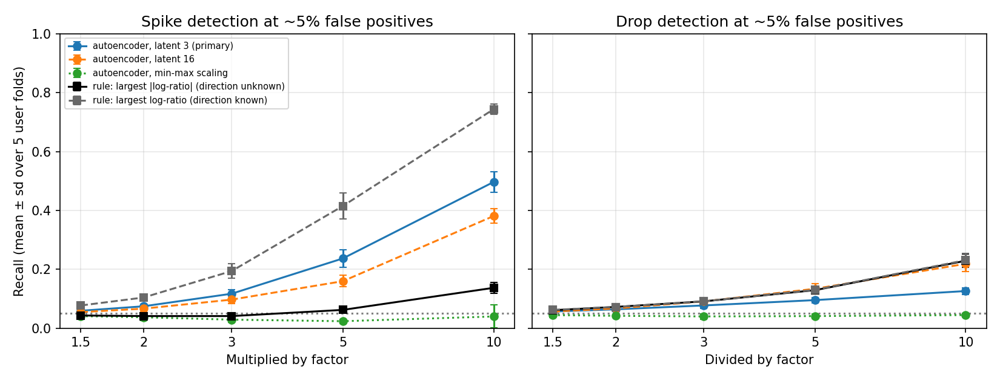

> **DRAFT written by Claude on 2026-11-12 as a scaffold for the author to rewrite in their own words.** Every number below was copied from `docs/sweeps/`, `docs/explanation_eval/`, or computed from the data that day. Results are given as mean ± standard deviation across the five user folds unless stated. `[CHECK]` = verify; `[YOUR CALL]` = your judgment.

# 4. Results

## 4.1 Three problems found in the course-project pipeline

**Data loss.** The original loader kept under a third of the data. Table 4.1 and Figure 4.1 show the effect of each fix.

**Table 4.1. Rows and sequences kept at each stage.**

| Stage | Rows | % of 15,900 | Sequences | Users with a sequence |
|---|---|---|---|---|
| Original loader (ISO dates, plain numbers) | 4,977 | 31.3% | 1,104 | 148 |
| Robust parsing, duplicates removed | 14,011 | 88.1% | 7,633 | 150 |
| Also dropping corrupt amounts (primary) | 13,638 | 85.8% | 7,281 | 150 |

The original loader produced no sequences at all for freelance income or savings, and 87% of its windows came from food, rent, and travel. The corrected pipeline has sequences in all 13 categories (Table 3.2), although income categories remain rare.

**Min-max scaling discards size.** Scaling each window to [0, 1] makes a window of 100 to 500 identical to one of 10,000 to 50,000. A practical consequence appeared in the original pipeline: 173 of 1,104 windows (15.7%) contained a corrupt amount, yet only 4 of the 52 windows it flagged did, because one extreme value squashes the rest of its window toward zero, which the model reconstructs well.

**The evaluation was invalid.** The original test overwrote a normalized value with 2.0 or −0.5, which cannot occur in normalized data (Section 3.6). Under that test the course-project models scored 98.2% spike recall with the original sequence-level split and 100% with the user-level split (Section 4.9). Those figures measured whether the model could detect an impossible input.

## 4.2 The course-project detector, re-evaluated realistically

Re-testing by changing one raw amount (Section 3.6) gives the picture in Table 4.2. For every configuration that scales windows to [0, 1], recall equals the false-positive rate within a point or two: the detector flags altered windows about as often as untouched ones. Under five-fold cross-validation, min-max scaling with a latent size of 3 is slightly *below* chance for spikes (for example 2.4 ± 0.7% at ×5, against a false-positive rate of about 5%).

**Table 4.2. Recall (%) at a ~5% false-positive rate with min-max scaling.**

| Evaluation | Spike ×3 | ×5 | ×10 | Drop ÷3 | ÷5 | ÷10 |
|---|---|---|---|---|---|---|
| Course-project model, one split (127 windows, FPR 6.3%) | 8 | 2 | 1 | 4 | 3 | 6 |
| Robust parsing, one split (1,070 windows, FPR 5.0%) | 2 | 2 | 1 | 4 | 5 | 4 |
| Robust parsing, 5-fold cross-validation | 2.9 ± 0.9 | 2.4 ± 0.7 | 4.0 ± 3.9 | 4.0 ± 0.9 | 4.1 ± 0.8 | 4.5 ± 0.7 |

*(The first two rows used a latent size of 16, the course project's setting; the cross-validated row used a latent size of 3.)*

## 4.3 Detection with user-relative features, cross-validated

With amounts expressed relative to the user's typical amount (Section 3.2), the autoencoder does detect large spikes (Table 4.3 and Figure 4.2). The primary configuration, with a latent size of 3, flags a charge ten times too large in **49.7 ± 3.5%** of cases, five times too large in 23.7 ± 3.0%, and three times too large in 11.7 ± 1.5%. At a factor of 2 or less it is close to chance (7.4 ± 0.7% at ×2 against a false-positive rate near 5%). Downward changes are detected much less well: dividing an amount by ten is caught 12.6 ± 1.1% of the time.

The larger latent size of 16 does better on drops (21.9 ± 2.5% at ÷10) and worse on spikes (38.1 ± 2.5% at ×10). The false-positive rate averaged 5.0% across folds in every configuration. The single-split result for the primary model (51.9% at ×10) agrees with the cross-validated mean, and the fold-to-fold standard deviations are small relative to the differences between configurations, so the ranking of configurations does not depend on which users were held out. Standard deviations come from only five folds, so they are themselves rough.

**Table 4.3. Autoencoder recall (%), mean ± sd over five user folds, at ~5% false positives.**

| Configuration | Spike ×3 | ×5 | ×10 | Drop ÷3 | ÷5 | ÷10 |
|---|---|---|---|---|---|---|
| **Log-ratio, latent 3 (primary)** | 11.7 ± 1.5 | 23.7 ± 3.0 | **49.7 ± 3.5** | 7.7 ± 1.0 | 9.5 ± 0.9 | 12.6 ± 1.1 |
| Log-ratio, latent 16 | 9.7 ± 1.3 | 16.0 ± 1.9 | 38.1 ± 2.5 | 9.1 ± 0.8 | 13.4 ± 1.8 | 21.9 ± 2.5 |
| Min-max scaling, latent 3 | 2.9 ± 0.9 | 2.4 ± 0.7 | 4.0 ± 3.9 | 4.0 ± 0.9 | 4.1 ± 0.8 | 4.5 ± 0.7 |

## 4.4 Comparison with untrained rules

The same folds and the same injected anomalies were scored with the three one-line rules of Section 3.6. A rule that looks at the largest absolute value in a window, without knowing the direction of the anomaly, is much worse than the autoencoder on spikes (13.7 ± 1.8% at ×10) and better on drops (22.9 ± 2.2% at ÷10). A rule that knows the anomaly is a spike and looks only at the largest value reaches **74.4 ± 1.7%** at ×10, **41.5 ± 4.4%** at ×5, and 19.4 ± 2.5% at ×3, all above the autoencoder; a rule that knows it is a drop reaches 23.1 ± 2.3% at ÷10, about the same as the latent-16 autoencoder and above the primary one (Table 4.4, Figure 4.2).

**Table 4.4. Recall (%) of untrained rules on the same folds, mean ± sd.**

| Rule | Spike ×3 | ×5 | ×10 | Drop ÷3 | ÷5 | ÷10 |
|---|---|---|---|---|---|---|
| Largest \|log-ratio\| (direction unknown) | 4.1 ± 0.4 | 6.2 ± 0.5 | 13.7 ± 1.8 | 9.1 ± 0.5 | 12.9 ± 1.1 | 22.9 ± 2.2 |
| Largest log-ratio (assumes spike) | 19.4 ± 2.5 | 41.5 ± 4.4 | 74.4 ± 1.7 | n/a | n/a | n/a |
| Most negative log-ratio (assumes drop) | n/a | n/a | n/a | 9.1 ± 0.6 | 13.0 ± 1.1 | 23.1 ± 2.3 |

Two points follow. First, the autoencoder, which is not told the direction, does much better than the direction-unknown rule on spikes and worse on drops, which is consistent with it having learned that very large values are rare in the training data (a hypothesis I did not test). Second, once a rule is allowed the direction knowledge that the autoencoder lacks, it matches or beats the autoencoder in both directions. The direction-aware rules would not be available in deployment, but they show that the autoencoder does not extract more from this data than a simple function of the features.

## 4.5 What the dataset looks like

Several measurements suggest the data contain no per-user or time structure for a sequence model to learn (all on the cleaned data).

- **No persistent user level.** If users differed in how much they typically spend in a category, the share of variance in log-amount explained by user (the intraclass correlation) would be well above zero. It is −0.004 for food, −0.004 for rent, and −0.007 for travel, across all 150 users: indistinguishable from zero. Which user a transaction belongs to tells you nothing about its size.
- **No time structure.** The lag-1 autocorrelation of log-amount within a user and category, over the 509 groups with at least ten transactions, averages −0.070 (standard deviation across groups 0.241). A transaction does not predict the next one.
- **Bounded amounts, with rent different.** For every expense category except rent, essentially no amounts exceed 10,000 (the 99th percentile is 9,744 to 9,932 and the share above 10,000 is 0.0%), whereas for rent 35.3% of amounts exceed 10,000 and the 99th percentile is 48,986 (Table 4.5). Rent looks like a mixture of a bounded component and a high-amount component.

**Table 4.5. Expense amounts by category (cleaned data).**

| Category | Median | 90th pct | 99th pct | Share above 10,000 |
|---|---|---|---|---|
| food | 3,370 | 7,875 | 9,744 | 0.0% |
| rent | 8,019 | 39,219 | 48,986 | 35.3% |
| travel | 5,133 | 9,036 | 9,912 | 0.0% |
| utilities | 5,077 | 8,994 | 9,866 | 0.0% |
| entertainment | 5,122 | 9,044 | 9,924 | 0.0% |
| education | 5,305 | 9,187 | 9,932 | 0.0% |
| health | 5,135 | 8,783 | 9,860 | 0.0% |

These measurements are why I describe the data as synthetic: real rent, in particular, is highly persistent per user. It also means that a user's "typical amount" is mostly sample noise around a category-level value, and that nothing in the order or the user identity gives an LSTM an advantage over a rule applied to a single window.

## 4.6 The primary model

**Latent size and scoring.** The primary model reaches a validation error of 0.151, whereas the latent-16 model reaches 0.0005, which shows it can nearly copy its five inputs. Scoring each window by the largest per-position error instead of the mean makes no material difference on the single split (spike ×10: 51.9% with the mean, 53.6% with the maximum; drop ÷10: 13.0% against 12.3%). The hypothesis in the course project that averaging dilutes a single bad position is not supported.

**What it flags.** The 95th-percentile threshold of the validation errors is 0.522. Over all users, 349 of 7,281 windows (4.8%) are flagged. Flagged windows contain larger deviations: the median of the largest absolute log-ratio in a window is 2.07 for flagged windows against 1.39 for the others. The flags are highly concentrated in one category (Table 4.6): 233 of the 349 (66.8%) are rent windows, although rent is 23.9% of all windows. This follows from the dataset: rent amounts are far more spread out (Table 4.5), so rent windows more often contain a value far from the user's median. Because windows overlap, one unusual transaction can appear in up to five flagged windows; two of the six highest-scoring windows in Figure 4.3 contain the same 237 rent charge. Counts of flagged windows are therefore not counts of unusual transactions.

**Table 4.6. Flagged windows by category.**

| Category | Flagged | Category | Flagged |
|---|---|---|---|
| rent | 233 | education | 7 |
| food | 46 | entertainment | 4 |
| travel | 19 | health | 3 |
| other | 18 | salary | 3 |
| utilities | 11 | bonus, investment | 2 each |
| | | freelance | 1 |

## 4.7 Explanation evaluation

An informal first trial (v1, five flagged windows, outputs in `docs/explanation_eval/llm_runs/`) showed the small model stating the wrong direction in one case, never mentioning the flagged amount in two, and adding content that is not in the facts (a dollar sign, a data-entry error) in four. Three structured rounds of 20 windows each followed (Section 3.8). Table 4.7 gives the share of texts meeting each criterion, as judged by Claude, with 95% Wilson intervals for the all-four rate.

**Table 4.7. Share of 20 explanations meeting each criterion (LLM-judged).**

| Round and text | Direction | Numbers | Plain language | No invented causes | **All four** (95% interval) |
|---|---|---|---|---|---|
| v2 prompt, language model | 95% | 65% | 95% | 100% | **55%** (34–74) |
| v2, template | 95% | 100% | 90% | 100% | 90% (70–97) |
| v3 prompt, language model | 95% | 80% | 95% | 90% | **65%** (43–82) |
| v3, template | 95% | 100% | 90% | 100% | 90% (70–97) |
| v4 (primary model), language model | 100% | 95% | 95% | 100% | **95%** (76–99) |
| v4, template | 100% | 100% | 100% | 100% | 100% (84–100) |

*(Rounds v2 and v3 use the same 20 windows from the course-project detector; v4 uses 20 windows from the primary detector and is not comparable with them.)*

**What went wrong with the small model.** In v2, the typical failure was misusing a real number: seven texts described the ratio of a window's score to the threshold as "the threshold of 1.06" (or similar), a true number attached to the wrong thing. Hiding the score fields from the model in v3 removed that kind of failure. The v3 failures were different: a currency symbol that is not in the facts ("$16334.0"), differences computed wrongly ("214 higher" where the real gap was 2,614), and invented explanations ("part of a pattern", a "potential data-entry error"). In v4 the one text that failed the rubric said that the flagged amount was "4 positions higher than the median", using a window position as if it were a quantity.

**What the checker did.** The grounding check rejected 2 of 20 language-model texts in v2, 5 in v3, and none in v4. It never rejected a text the judge considered fully correct. But it also let through texts that failed the rubric: of the 18 texts it passed in v2, 11 were fully correct (61%); in v3, 13 of 15 (87%); in v4, 19 of 20 (95%). Most of the failures that got through were of the kind it cannot see, a real number used wrongly (all seven in v2 and the one in v4). The other two, in v3, were an invented cause phrased outside the checker's vocabulary ("part of a pattern") and a claim that an amount equal to the typical amount was "higher".

**What would be shown to a user.** If the language-model text is shown only when it passes the check, and the template otherwise, the share of fully correct texts shown is 60% (12 of 20) in v2, 90% (18 of 20) in v3, and 95% (19 of 20) in v4. In v3 and v4 this is statistically indistinguishable from the template alone (90% and 100%).

## 4.8 How far the judge can be trusted

I scored 12 of the 40 round-v2 texts myself, and the judge's scores agreed on 39 of 48 criterion judgments (81%) and on the overall verdict ("all four met or not") for 9 of 12 texts. Agreement by criterion was 100% for invented causes, 92% for direction, 75% for numbers, and 58% for plain language. Plain language is the least reliable and the most subjective. The disagreements were mostly about two things: whether "1.0x higher" when the flagged amount equals the typical amount counts as a wrong direction or as confusing wording, and whether a true number used in the wrong place counts against the numbers criterion. This check was done once, on round v2 only, so it does not establish the judge's reliability on v3 and v4. Twelve texts is also too few for a confidence interval that would be informative.

## 4.9 Course-project results, for the record

The course-project pipeline (4,977 rows, 1,104 windows, min-max features) gave the following results under the invalid out-of-range test. Moving from a sequence-level split to a user-level split raised the validation error from 0.0491 to 0.0577, as expected once near-copies could no longer appear on both sides; the number of flagged windows fell from 64 (5.8%) to 52 (4.7%); and spike and drop recall under the invalid test were 98.2% and 30.3% (sequence split) and 100% and 32.9% (user split). These numbers are not evidence of detection ability (Sections 4.1 and 4.2).
