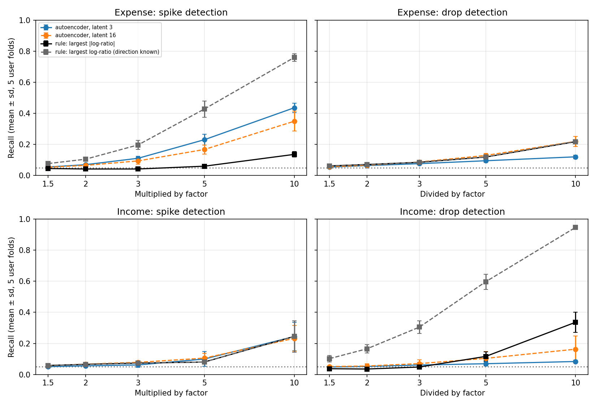
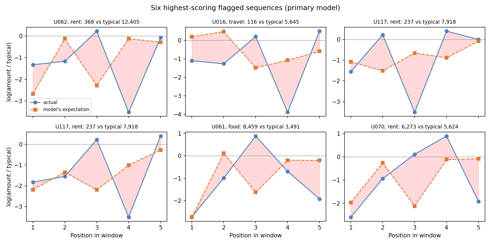

> **DRAFT written by Claude on 2026-11-12 (updated the same evening after a grouping fix and new experiments) as a scaffold for the author to rewrite in their own words.** Every number was copied from `docs/sweeps/`, `docs/explanation_eval/`, or computed from the data that day. Results are mean ± standard deviation across five user folds unless stated. `[CHECK]` = verify; `[YOUR CALL]` = your judgment.

# 4. Results

## 4.1 Four problems found in the course-project pipeline

**Data loss.** The original loader kept under a third of the data (Table 4.1, Figure 4.1).

**Table 4.1. Rows and windows kept at each stage.**

| Stage | Rows | % of 15,900 | Windows | Users with a window |
|---|---|---|---|---|
| Original loader (ISO dates, plain numbers) | 4,977 | 31.3% | 1,104 | 148 |
| Robust parsing, duplicates removed | 14,053 | 88.4% | 8,882 | 150 |
| Also dropping corrupt amounts (primary) | 13,680 | 86.0% | 8,537 | 150 |

The original loader produced no windows at all for freelance income or savings, and 87% of its windows came from food, rent, and travel. The corrected pipeline has windows for income and every expense category.

**Min-max scaling discards size.** Scaling each window to [0, 1] makes a window of 100 to 500 identical to one of 10,000 to 50,000. In the original pipeline, 173 of 1,104 windows (15.7%) contained a corrupt amount, yet only 4 of the 52 windows it flagged did, because one extreme value squashes the rest of its window toward zero, which the model reconstructs well.

**Windows mixed income and expenses, and income was nearly absent.** Windows were first grouped by user and category only. The category "other" exists on both the expense and the income side, so 108 of its 140 windows mixed income (median amount 44,814) with expenses (median 4,918) in one history. Income categories were also split five ways with about three transactions per user each, leaving only 144 income windows (2%). Grouping by user, transaction type, and category and pooling each user's income into one history gives 1,537 income windows (18%).

**The evaluation was invalid.** The original test overwrote a normalized value with 2.0 or −0.5, which cannot occur in normalized data (Section 3.6). It scored the course-project models at 98.2% spike recall (sequence-level split) and 100% (user-level split), which measured whether the model could detect an impossible input (Section 4.11).

## 4.2 The course-project detector, re-evaluated realistically

Re-testing by changing one raw amount (Section 3.6) gives Table 4.2. For every configuration that scales windows to [0, 1], recall equals the false-positive rate within a point or two. Under five-fold cross-validation on the current data, min-max scaling is at or below chance (for example 2.1 ± 0.5% for a fivefold spike, against a false-positive rate of about 5%).

**Table 4.2. Recall (%) at a ~5% false-positive rate with min-max scaling.**

| Evaluation | Spike ×3 | ×5 | ×10 | Drop ÷3 | ÷5 | ÷10 |
|---|---|---|---|---|---|---|
| Course-project model, one split (127 windows, FPR 6.3%) | 8 | 2 | 1 | 4 | 3 | 6 |
| Robust parsing, old grouping, one split (1,070 windows) | 2 | 2 | 1 | 4 | 5 | 4 |
| Current data, 5-fold cross-validation, latent 3 | 2.7 ± 0.4 | 2.1 ± 0.5 | 2.1 ± 1.5 | 4.4 ± 0.4 | 4.3 ± 0.4 | 4.7 ± 0.4 |

*(The first two rows used latent size 16, the course project's setting.)*

## 4.3 Cross-validated detection with user-relative features

With amounts expressed relative to the user's typical amount (Section 3.2), the autoencoder detects large spikes (Table 4.3, Figure 4.2). The primary configuration (latent size 3) flags a charge ten times too large in **41.0 ± 3.7%** of cases, five times too large in 20.3 ± 2.8%, and three times too large in 10.1 ± 1.3%; at a factor of 2 or less it is close to chance. Downward changes are detected much less well (11.5 ± 0.9% at ÷10). The larger latent size of 16 does better on drops (21.0 ± 3.8% at ÷10) and worse on spikes (32.9 ± 7.5% at ×10) and has a larger fold-to-fold spread. The false-positive rate averaged 5.0% in every configuration. Scoring by the largest per-position error instead of the mean makes no material difference on the single split (spike ×10: 44.6% against 42.1%; drop ÷10: 12.1% against 13.8%), so the course-project hypothesis that averaging dilutes a single bad position is not supported. Standard deviations come from five folds, so they are rough.

**Table 4.3. Autoencoder recall (%), all windows, mean ± sd over five user folds.**

| Configuration | Spike ×3 | ×5 | ×10 | Drop ÷3 | ÷5 | ÷10 |
|---|---|---|---|---|---|---|
| **Log-ratio, latent 3 (primary)** | 10.1 ± 1.3 | 20.3 ± 2.8 | **41.0 ± 3.7** | 7.3 ± 1.1 | 8.9 ± 0.9 | 11.5 ± 0.9 |
| Log-ratio, latent 16 | 9.1 ± 1.0 | 15.2 ± 3.0 | 32.9 ± 7.5 | 8.5 ± 1.1 | 12.9 ± 2.2 | 21.0 ± 3.8 |
| Min-max scaling, latent 3 | 2.7 ± 0.4 | 2.1 ± 0.5 | 2.1 ± 1.5 | 4.4 ± 0.4 | 4.3 ± 0.4 | 4.7 ± 0.4 |

## 4.4 Comparison with untrained rules

The same folds and injected anomalies were scored with the three one-line rules of Section 3.6 (Table 4.4, Figure 4.2). The direction-unknown rule is much worse than the autoencoder on spikes (15.3 ± 1.6% at ×10) and better on drops (23.5 ± 2.5% at ÷10). A rule that knows the anomaly is a spike reaches **73.6 ± 4.1%** at ×10, 36.9 ± 6.9% at ×5, and 16.3 ± 2.8% at ×3, all above the autoencoder; a rule that knows it is a drop reaches 23.6 ± 2.4% at ÷10, above the primary autoencoder and about equal to the latent-16 one. The autoencoder, which is not told the direction, beats the direction-unknown rule on spikes and loses on drops, consistent with it having learned that very large values are rare in training (a hypothesis I did not test). Once a rule is allowed direction knowledge, it matches or beats the autoencoder in both directions. Those rules would not be available in deployment; the point is that the autoencoder does not extract more from this data than a simple function of the features.

**Table 4.4. Recall (%) of untrained rules, all windows, mean ± sd.**

| Rule | Spike ×3 | ×5 | ×10 | Drop ÷3 | ÷5 | ÷10 |
|---|---|---|---|---|---|---|
| Largest \|log-ratio\| (direction unknown) | 5.0 ± 0.2 | 7.4 ± 0.8 | 15.3 ± 1.6 | 8.3 ± 0.4 | 12.3 ± 1.0 | 23.5 ± 2.5 |
| Largest log-ratio (assumes spike) | 16.3 ± 2.8 | 36.9 ± 6.9 | 73.6 ± 4.1 | n/a | n/a | n/a |
| Most negative log-ratio (assumes drop) | n/a | n/a | n/a | 8.3 ± 0.4 | 12.4 ± 0.9 | 23.6 ± 2.4 |

## 4.5 Expenses versus income

Because the intended use covers both unexpected expenses and unexpected income (Section 1.3), recall was also computed separately for each stream, with the threshold calibrated within the stream (Table 4.5, Figure 4.3). Expenses behave like the pooled results: the autoencoder finds 43.6 ± 3.0% of tenfold spikes against 76.0 ± 2.4% for the direction-aware rule.

Income differs. For an unexpectedly **low** income payment, a one-line rule is far better than the autoencoder: at a tenfold drop it flags 94.7 ± 1.4% of cases (59.7 ± 4.9% at ÷5), against 8.3 ± 0.9% for the primary autoencoder and 16.3 ± 8.5% for the latent-16 one. A plausible reason is that income rarely falls below about 10,000 (first percentile 10,712), so a tenfold drop moves a payment out of the normal range, a boundary the rule uses directly; I did not test this. For unexpectedly **high** income, all methods are weak and tied (about 24% at ×10, with a standard deviation of 8 to 10 points), perhaps because 4.6% of income amounts already exceed 100,000, so a high income payment is less unusual. Income has about 300 windows per fold, so these estimates are noisier than the expense ones.

**Table 4.5. Recall (%) by stream, mean ± sd over five user folds.**

| Stream and method | Spike ×5 | ×10 | Drop ÷5 | ÷10 |
|---|---|---|---|---|
| **Expense** (7,000 windows): autoencoder, latent 3 | 23.0 ± 3.5 | 43.6 ± 3.0 | 9.5 ± 1.0 | 12.0 ± 1.2 |
| Expense: autoencoder, latent 16 | 16.8 ± 3.0 | 34.9 ± 6.4 | 12.9 ± 1.3 | 22.0 ± 3.2 |
| Expense: rule, direction known | 42.8 ± 5.2 | 76.0 ± 2.4 | 11.9 ± 1.0 | 21.8 ± 1.3 |
| **Income** (1,537 windows): autoencoder, latent 3 | 9.9 ± 4.8 | 24.4 ± 9.1 | 6.9 ± 1.4 | 8.3 ± 0.9 |
| Income: autoencoder, latent 16 | 10.5 ± 3.0 | 23.2 ± 8.2 | 10.4 ± 4.3 | 16.3 ± 8.5 |
| Income: rule, direction known | 8.0 ± 1.4 | 24.5 ± 10.1 | **59.7 ± 4.9** | **94.7 ± 1.4** |

## 4.6 What the datasets look like

**BudgetWise.** Several measurements suggest the data contain no per-user or time structure for a sequence model to learn (cleaned data).

- **No persistent user level.** The share of variance in log-amount explained by user (intraclass correlation) is −0.004 for food, −0.004 for rent, and −0.007 for travel across all 150 users, and −0.001 for pooled income: indistinguishable from zero.
- **No time structure.** The lag-1 autocorrelation of log-amount within a user and category averages −0.070 (standard deviation across 509 histories 0.241); for pooled income it is −0.107 (131 histories).
- **Bounded amounts, with rent different.** For every expense category except rent, essentially no amount exceeds 10,000 (the 99th percentile is 9,744 to 9,932), whereas 35.3% of rent amounts exceed 10,000 (99th percentile 48,986) (Table 4.6). Income amounts have a median of 46,713, a first percentile of 10,712, and a heavy tail (4.6% above 100,000).

**Table 4.6. Expense amounts by category (cleaned data).**

| Category | Median | 90th pct | 99th pct | Share above 10,000 |
|---|---|---|---|---|
| food | 3,370 | 7,875 | 9,744 | 0.0% |
| rent | 8,019 | 39,219 | 48,986 | 35.3% |
| travel | 5,133 | 9,036 | 9,912 | 0.0% |
| utilities | 5,077 | 8,994 | 9,866 | 0.0% |
| entertainment | 5,122 | 9,044 | 9,924 | 0.0% |
| education | 5,305 | 9,187 | 9,932 | 0.0% |
| health | 5,135 | 8,783 | 9,860 | 0.0% |

I describe the data as synthetic for these reasons: real rent, in particular, is usually persistent per user `[YOUR CALL: this is an inference, not a measured fact]`. A user's "typical amount" is mostly sample noise around a category-level value, and nothing in order or user identity gives an LSTM an advantage over a rule applied to one window.

**Sparkov (simulated card transactions with fraud labels).** This dataset is also synthetic (generated from per-customer profiles) but has more structure: the lag-1 autocorrelation is 0.019 (12,643 histories), so there is still no time structure, while the intraclass correlation by user is 0.710 for grocery purchases and about 0.09 for gas and home, so a customer's level is persistent in some categories and not in others.

## 4.7 The primary model

The primary model has latent size 3, was trained on 7,289 windows from 128 users, and has a validation error of 0.144 (0.0004 for latent 16, which nearly copies its input). The 95th-percentile threshold of the 1,248 validation windows' errors is 0.573, and over all 8,537 windows, **383 (4.5%)** are flagged: 273 of 7,000 expense windows (3.9%) and 110 of 1,537 income windows (7.2%). Flagged windows show larger deviations (median largest absolute log-ratio 2.16 against 1.31 for the rest). The flags are concentrated in one category (Table 4.7): 211 of the 383 (55.1%) are rent windows, although rent is 20.3% of all windows, because rent amounts are far more spread out (Table 4.6). Because windows overlap, one unusual transaction can appear in up to five flagged windows, so flag counts are not counts of unusual transactions.

**Table 4.7. Flagged windows by category.**

| Category | Flagged / windows |
|---|---|
| rent | 211 / 1,737 |
| income (pooled) | 110 / 1,537 |
| food | 29 / 2,330 |
| travel | 17 / 1,140 |
| utilities | 6 / 793 |
| education | 5 / 334 |
| entertainment | 3 / 558 |
| health | 2 / 92 |

## 4.8 Detection against real fraud labels

On the Sparkov data, anomalies need not be injected: transactions are labeled as fraudulent or not. Windows from 199 held-out customers (390,505 windows, of which 5,358 contain a fraudulent transaction, a base rate of 1.4%) were scored by the autoencoder trained on a subset of the training customers' windows and by the untrained rules, using only the amount (Table 4.8). A score is judged by its AUROC (0.5 is chance), its average precision (chance 0.014), and the share of fraud windows caught when the top 5% of windows are flagged.

The latent-3 autoencoder is poor: it ranks fraud only slightly better than chance (AUROC 0.64, average precision 0.025, 13.2% caught), and four times more training windows or a different set of held-out customers does not change that (0.630 and 0.653). The latent-16 autoencoder is much better (AUROC 0.708, average precision 0.070, 28.5% caught) and ties the best rule on average precision (0.070), but remains below it on AUROC (0.732) and on the share caught (37.2%). No autoencoder beat the one-line rule that flags the window with the largest deviation from the customer's typical amount.

**Table 4.8. Fraud detection on held-out customers (any fraudulent transaction in the window).**

| Score | AUROC | Average precision | Caught at 5% flagged |
|---|---|---|---|
| Autoencoder, latent 3 (150k training windows) | 0.638 | 0.025 | 13.2% |
| Autoencoder, latent 3 (600k windows) | 0.630 | 0.026 | 12.5% |
| Autoencoder, latent 3 (different customers) | 0.653 | 0.026 | 12.7% |
| Autoencoder, latent 16 | 0.708 | 0.070 | 28.5% |
| Rule: largest \|log-ratio\| | **0.732** | **0.070** | **37.2%** |
| Rule: largest log-ratio | 0.729 | 0.072 | 37.1% |
| Rule: most negative log-ratio | 0.466 | 0.013 | 2.7% |

## 4.9 Explanation evaluation

An informal first trial (v1, five windows, outputs in `docs/explanation_eval/llm_runs/`) showed the small model stating the wrong direction once, never mentioning the flagged amount twice, and adding content that is not in the facts (a dollar sign, a data-entry error) in four. Six structured rounds followed (Section 3.8); Table 4.9 gives the share of texts fully correct, as judged by Claude, with 95% Wilson intervals.

**Table 4.9. Explanation rounds (20 windows each; LLM-judged).**

| Round | Windows | Language model fully correct (95% interval) | Template | What happened |
|---|---|---|---|---|
| v2 | course-project detector's flags | 55% (34–74) | 90% (70–97) | seven texts called a score ratio "the threshold of 1.06" |
| v3 | same 20 windows | 65% (43–82) | 90% (70–97) | a currency symbol, wrong differences, invented causes |
| v4 | earlier primary model (before the grouping fix) | 95% (76–99) | 100% (84–100) | one window position used as a quantity |
| v5 | new primary model, income included | 70% (48–85) | 100% (84–100) | **four of five income texts said the user "spends" the income**; one `$`; one field-name phrase |
| v6 | same 20 as v5 | checker passed 4 of 20 (not judged by hand) | n/a | a prompt rewrite made the model write a `$` in 16 of 20 texts |
| v7 | same 20 as v5 | **95% (76–99)** | 100% (84–100) | one invented cause ("may have made a mistake when entering the amount") |

Rounds v2 and v3 use the same 20 windows and are directly comparable; v4 used a different model's flags (and earlier windows), so v4 is not comparable with v2 and v3; v5, v6, and v7 use the same 20 windows. The v5 failure is specific to income: the prompt called the flags "spending-anomaly flags" and the model was never told whether a window was income or expense. A stricter checker rule (income described as spending) would have rejected all four, along with the other two failures. A prompt that added the transaction type (v6) made things much worse, then a rewritten prompt with the no-currency rule first (v7) fixed it, which shows that a 3-billion-parameter model is brittle to wording; all prompts are listed in `docs/explanation_eval/prompts.md`.

**What the checker did.** It passed 18 of 20 language-model texts in v2, 15 in v3, 19 in v5 (before it was extended), and 20 in v7, and it never rejected a text the judge considered fully correct. The texts it passed that failed the rubric were of the kind it cannot see: a real number used for the wrong thing (seven in v2), income described as spending (four in v5, before the rule), an amount equal to the typical amount called "higher" (one in v3), and an invented cause phrased outside its vocabulary (one each in v3 and v7). With the checker and the template fallback, the share of fully correct texts shown to a user is 60% (v2), 90% (v3), and 75% (v5).

**Caveat on v7.** Most v7 texts say only that the amount is higher or lower than typical and do not state how much, so they pass the rubric partly by saying less; the template states the multiple and how far past the threshold the window scored. The rubric has no criterion for informativeness. `[YOUR CALL: consider whether to add one.]`

## 4.10 How far the judge can be trusted

I scored 12 of the 40 round-v2 texts myself, and the judge's scores agreed on 39 of 48 criterion judgments (81%) and on the overall verdict for 9 of 12 texts. Agreement by criterion was 100% for invented causes, 92% for direction, 75% for numbers, and 58% for plain language (the most subjective). The disagreements were mostly about whether "1.0x higher" when the amount equals the typical amount counts as a wrong direction or as confusing wording, and whether a true number used in the wrong place counts against the numbers criterion. This was done once, on round v2 only, so it does not establish the judge's reliability on later rounds. Twelve texts is also too few for an informative confidence interval.

## 4.11 Course-project results, for the record

The course-project pipeline (4,977 rows, 1,104 windows, min-max features) gave these results under the invalid out-of-range test. Moving from a sequence-level to a user-level split raised the validation error from 0.0491 to 0.0577 (as expected once near-copies could no longer appear on both sides); the number of flagged windows fell from 64 (5.8%) to 52 (4.7%); and spike and drop recall under the invalid test were 98.2% and 30.3% (sequence split) and 100% and 32.9% (user split). These numbers are not evidence of detection ability (Sections 4.1 and 4.2).
